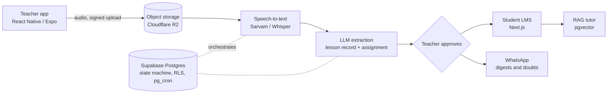

# Hi, I'm Pulkit Sachdeva

Computer Science undergrad at Punjab Engineering College (PEC), Chandigarh. I build AI-native software end to end:
mobile, web, database, and the speech and language models in between.

Looking for an **AI-native software development internship, June to July 2027**.

## Featured work: GyanSaar

**[gyansaar.com](https://gyansaar.com)** is an AI platform for teaching institutes. A teacher records a lecture on their phone.
GyanSaar transcribes it (Hindi and Hinglish included), turns it into a lesson summary and a draft assignment for the
teacher to approve, helps grade handwritten submissions, and gives students a doubt-clearing tutor that answers
from their own class. It is in a live pilot with a coaching institute.

I contribute across the whole stack. The code lives in the team's private repositories, so it does not show in my graph.

| Layer | What I worked with |
|---|---|
| Mobile | React Native, Expo Router, EAS, on-device voice activity detection, offline SQLite queue, push, Google Sign-In |
| Web | Next.js 16, React 19, Tailwind CSS, Astro, Vercel |
| Backend | Supabase: PostgreSQL, Deno / TypeScript Edge Functions, row-level security, pg_cron, SQL tests |
| AI | Speech-to-text (Sarvam Saaras, Whisper large-v3 on Modal / Groq / Cloudflare), LLMs via OpenRouter, RAG with pgvector |
| Integrations | Cloudflare R2 signed uploads, WhatsApp Cloud API, Firebase |

A few things it taught me:
- **Let the database be the orchestrator.** Each serverless function does one idempotent step, and a scheduled job retries anything that gets stuck. There is no separate workflow engine to keep alive.
- **Humans approve what AI proposes.** Assignments and marks reach students only after a teacher signs off.
- **Measure models before trusting them.** We compared speech-to-text providers on real cost per hour, speed and accuracy before choosing one.

## Projects

- **[hinglish-asr-bench](https://github.com/pulkitsachdeva508-ops/hinglish-asr-bench)**: a speech-to-text benchmark for Hindi and Hinglish. WER and CER written from scratch, Devanagari normalisation, and which script a model answers in. On FLEURS Hindi, Whisper large-v3-turbo reaches 29.5% WER, while tiny and base mostly reply in Latin or Urdu script.
- **[postgres-pipeline-template](https://github.com/pulkitsachdeva508-ops/postgres-pipeline-template)**: background jobs where Postgres is the state machine. Leases, `SKIP LOCKED`, retries with backoff and row-level security, with concurrency tested on a real Postgres server.
- **[class-notes-rag](https://github.com/pulkitsachdeva508-ops/class-notes-rag)**: ask your course notes. Next.js and pgvector, retrieval scoped to one course, citations checked in code, and it says "not in the notes" instead of guessing.

## Stack

TypeScript · Python · C++ · React · Next.js · React Native / Expo · Supabase / PostgreSQL · pgvector · RAG · Whisper · Vercel · Cloudflare

[LinkedIn](https://www.linkedin.com/in/pulkit-sachdeva-13a932393/)
